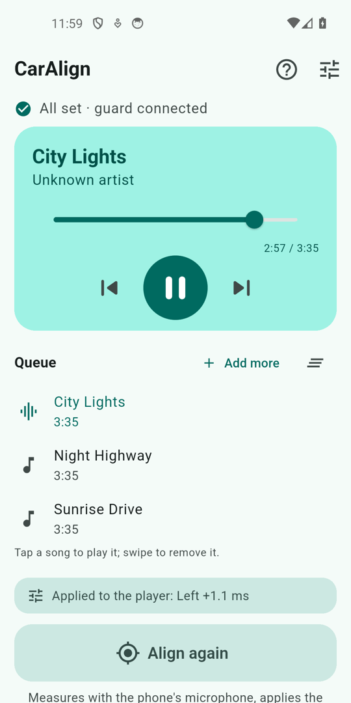
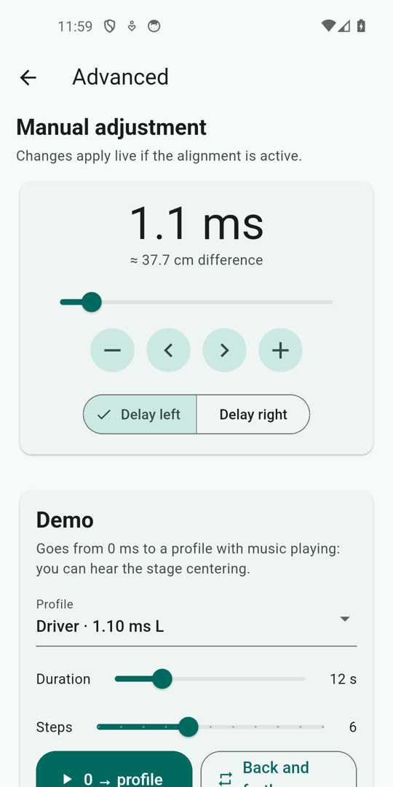
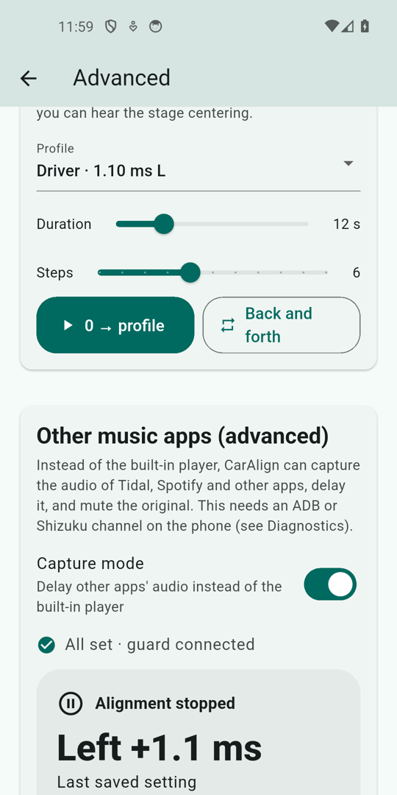
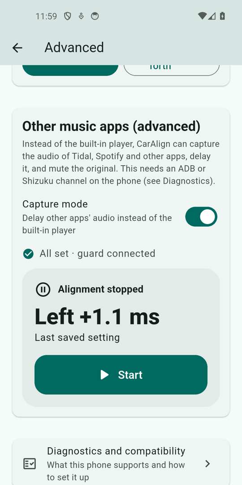
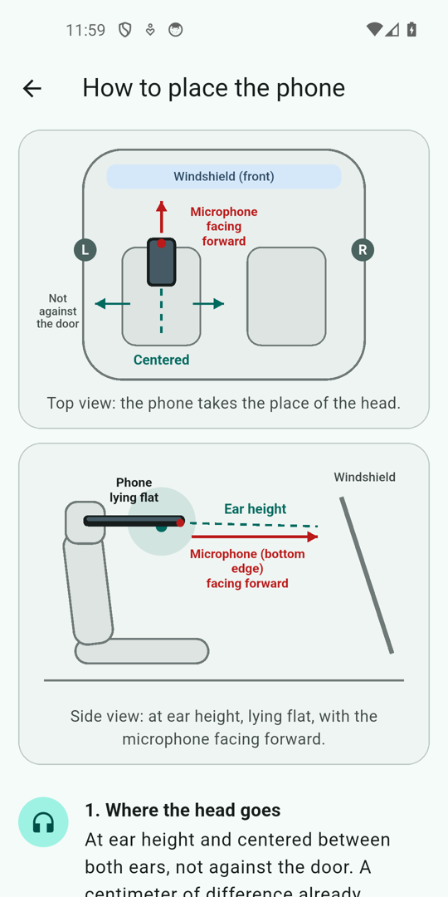

# CarAlign

**English** · [Español](README.es.md)

Aligns the timing of the left and right audio channels in a car, with no DSP. It measures with the phone's microphone how much later one side arrives than the other, then delays the channel that arrives first (on the order of 1 ms) so the sound centers on you.

Built for factory stereos with Android Auto or Bluetooth, which have no per-speaker delay adjustment.

## Two ways to use it

- **Built-in player (default).** Add songs from your phone and play them in CarAlign. The player applies the delay itself, so it works out of the box: no special permissions, no computer, nothing to set up. Then run the automatic alignment.
- **Capture mode (advanced).** Delay the audio of other apps such as Tidal or Spotify: CarAlign captures their audio, delays it and mutes the original. This needs a shell channel on the phone (ADB or Shizuku); see [Capture mode](#capture-mode-advanced).

<p align="center">
  
  
  
  
  
</p>

The app follows the phone's language (English and Spanish).

## Why it exists

In a car the driver doesn't sit in the middle: the left speaker is closer than the right one, so its sound arrives first and the stereo image drifts toward the door. Car audio processors (DSPs) fix this with a per-channel delay, but factory stereos don't have one. CarAlign applies that delay from the phone, which is what reaches the stereo over Android Auto or Bluetooth.

It was built for a VW Vento with an RCD stereo, a Jensen JA4B amplifier and passive 2-way Infinity speakers, and tested there.

## Inspiration

It doesn't imitate any particular app. It combines well-known ideas:

- **Time alignment in car audio DSPs**: the same adjustment, but on the phone and with only two channels.
- **Exponential sine sweep** (Farina's method), used in acoustic measurements: good signal-to-noise ratio, and arrival times can be measured to the microsecond using cross-correlation and parabolic interpolation.
- **Android audio capture (AudioPlaybackCapture) and apps that use ADB or Shizuku** to do what Android doesn't allow a regular app to do. That is why the limitation below exists.
- Libraries: [dadb](https://github.com/mobile-dev-inc/dadb) (ADB from inside the app) and [Shizuku](https://shizuku.rikka.app/).

## What to expect

- **Effect**: voices and the sound stage center in front of you. In my car the measured difference was about 1.1 to 1.3 ms (the right side arrived later, so the left is delayed), and by ear it sounded best slightly below the measurement (~0.96 ms). That's why there is a manual adjustment: the measurement is a good starting point, not the last word.
- **Which systems**: the effect is subtle and depends on the car. If your stereo already has time alignment, you don't need this.
- **Latency**: in capture mode, routing another app's audio through CarAlign adds about 90 to 170 ms. Fine for music; **not for watching video** (the sound will lag). The built-in player is not affected, because the app is the source.
- **A single value**: with two channels it only aligns left against right. It doesn't adjust each speaker separately, nor tweeters against woofers.
- **Fader**: if the rear speakers are active, the sound can seem to come from behind; keep the fader toward the front.
- **Measuring**: where you put the phone matters (one centimeter changes the result), so the app shows a guide and you should always place it the same way.
- **Testing status**: what was measured in a real car was one car and one phone. The built-in player, Bluetooth, Spotify and other phone brands haven't been verified in real use yet.

## How it works

1. The built-in player (ExoPlayer) decodes your songs and passes them through a delay line that changes in smooth steps, delaying one channel. In capture mode the audio of another app is captured (AudioPlaybackCapture) and played back through the same delay line, with the original muted.
2. Automatic alignment plays sweeps, records them with the microphone and computes the left/right difference by cross-correlation, in a closed loop (measure, apply, verify), and the result becomes the delay.
3. You can fine-tune it by ear with the manual adjustment, save profiles and try a step-by-step demo (all under *Advanced*).

## Capture mode (advanced)

The built-in player needs none of this. Capture mode is different: Android doesn't let a regular app mute another one, so to mute the original audio CarAlign needs a shell channel (ADB):

- With a computer: `adb tcpip 5555`, once every time the phone restarts. After that the app handles the rest over loopback.
- Or with [Shizuku](https://shizuku.rikka.app/) (fallback, not thoroughly tested).

Without that channel capture mode doesn't start (it fails safe: nothing gets muted). This can't be solved with code alone. Turn it on under *Advanced → Other music apps*.

## Compatibility

- Android 10 or later. Tested on Android 11, 14 and 16 emulators and on a Pixel 6.
- Untested: real Android 10/12/13 devices and other brands (Xiaomi and Samsung may need extra USB debugging settings).
- Built-in player: plays the common audio formats Android supports (MP3, AAC, FLAC, OGG, WAV…).
- Capture mode: works with any app that allows audio capture. Tidal and Spotify are on the known list; apps that block capture trigger a safety breaker that gives the sound back.
- *Advanced → Diagnostics and compatibility* has a copyable report and a "Test muting" button.

## Building

```
flutter pub get
flutter build apk --release        # or: flutter build appbundle --release
```

To sign, create `android/key.properties` (not committed):

```
storeFile=/path/to/your.jks
storePassword=...
keyAlias=upload
keyPassword=...
```

Tests: `flutter test` (Dart) and `tools/jvm_tests/run.sh` (Java simulations, no phone needed).

The app's texts live in `lib/i18n/` (English and Spanish, using [slang](https://pub.dev/packages/slang)); after editing them run `dart run slang`.

## Privacy

Everything happens on the phone. No accounts, ads or analytics, and the audio and microphone never leave the device. See [PRIVACY.md](PRIVACY.md) (English and Spanish).

## License

MIT
