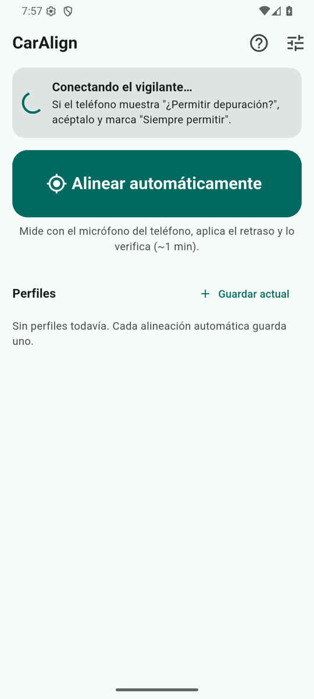
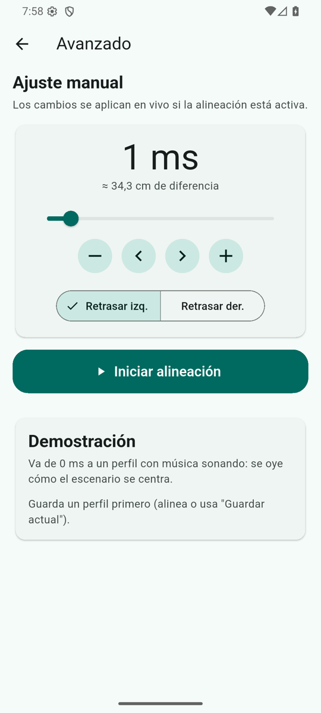
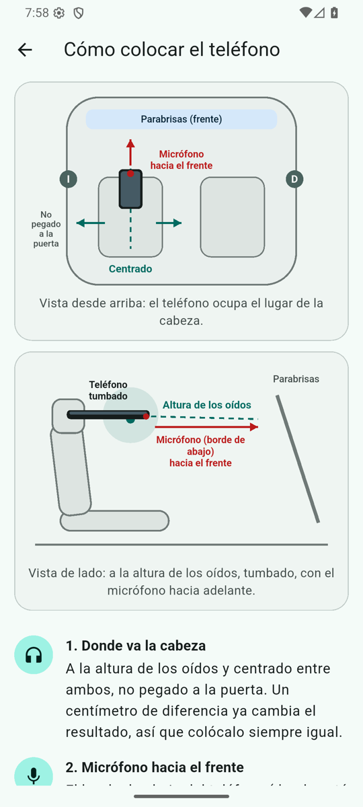
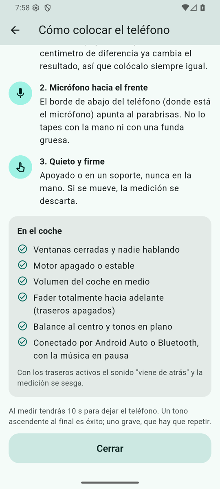

# CarAlign

Alinea en el tiempo los canales izquierdo y derecho del audio de un auto, sin DSP. Mide con el micrófono del teléfono la diferencia de llegada entre los dos lados y retrasa el canal que llega antes (del orden de 1 ms) para que el sonido se centre.

Pensado para estéreos de fábrica con Android Auto o Bluetooth, donde no hay ajuste de retardo por altavoz.

<p align="center">
  
  
  
  
</p>

## Cómo funciona

1. Captura el audio de la app de música (AudioPlaybackCapture).
2. Retrasa un canal con una línea de retardo de pasos suaves.
3. Lo reproduce y silencia el original.
4. La alineación automática emite barridos, los graba con el micrófono y calcula la diferencia por correlación cruzada, en lazo cerrado (mide, aplica, verifica).

## Limitación importante

Android no permite que una app normal silencie a otra. Para silenciar el audio original CarAlign necesita un canal de shell (ADB):

- Con un ordenador: `adb tcpip 5555` una vez cada vez que se reinicia el teléfono. Después la app se las arregla sola por loopback.
- O con [Shizuku](https://shizuku.rikka.app/) (respaldo, sin probar a fondo).

Sin ese canal la app no se activa (falla de forma segura: no silencia nada). Esto no se puede resolver solo con código, por eso no es una app de instalar y usar.

## Compatibilidad

- Android 10 o superior. Probada en emuladores Android 11, 14 y 16 y en un Pixel 6.
- Sin probar: Android 10/12/13 reales y otras marcas (Xiaomi y Samsung pueden pedir ajustes extra de depuración USB).
- Funciona con cualquier app que permita la captura de audio. Tidal y Spotify están en la lista conocida; las apps que bloquean la captura activan un freno de seguridad que devuelve el sonido.
- En *Avanzado → Diagnóstico y compatibilidad* hay un informe copiable y un botón "Probar silenciado".

## Compilar

```
flutter pub get
flutter build apk --release        # o: flutter build appbundle --release
```

Para firmar, crea `android/key.properties` (no se sube al repo):

```
storeFile=/ruta/a/tu.jks
storePassword=...
keyAlias=upload
keyPassword=...
```

Pruebas de simulación (Java, sin teléfono): `herramientas/pruebas_jvm/run.sh`.

## Privacidad

Todo ocurre en el teléfono. No hay cuentas, anuncios ni análisis, y el audio y el micrófono no salen del dispositivo. Ver [PRIVACY.md](PRIVACY.md).

## Licencia

MIT
